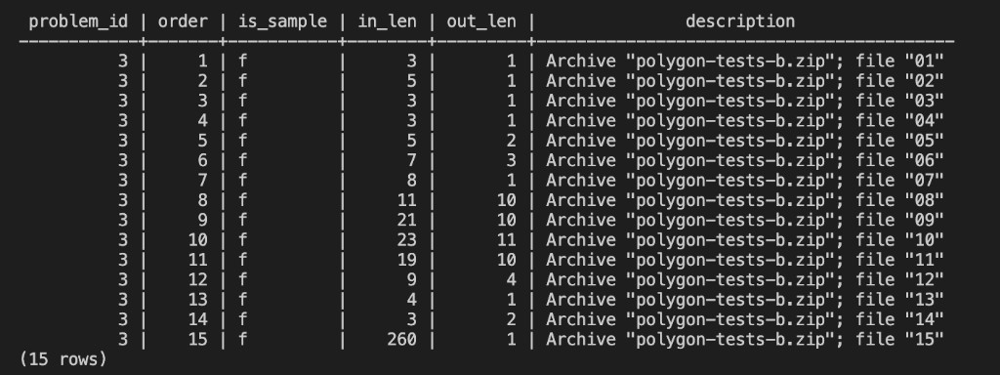
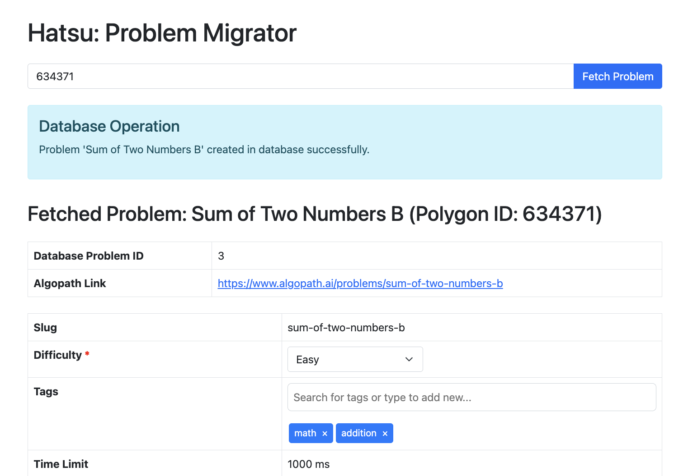
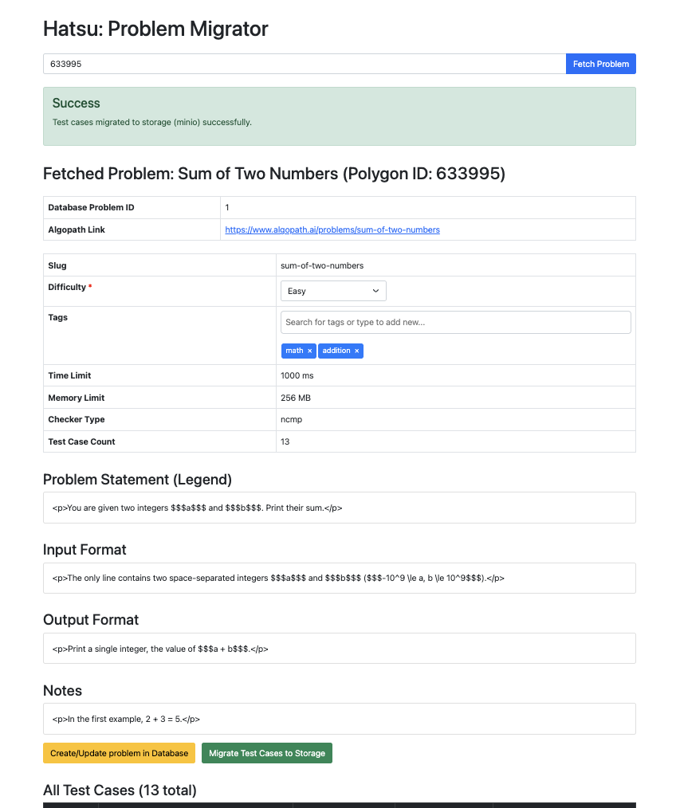
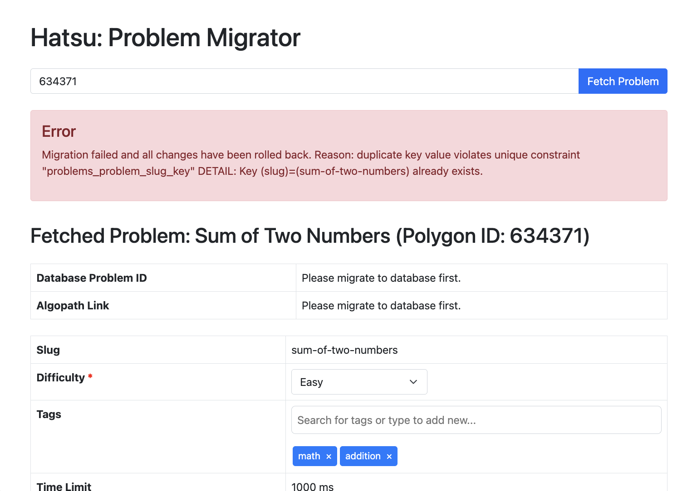
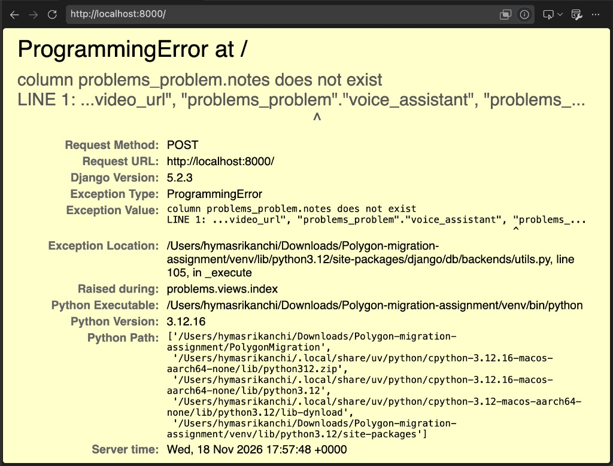
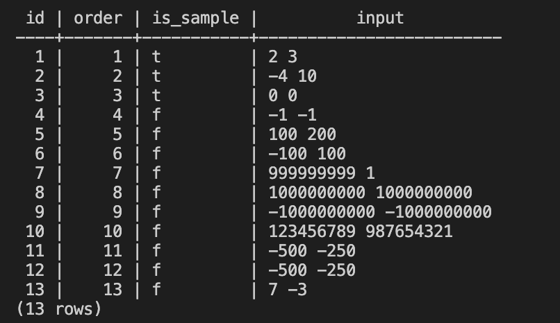
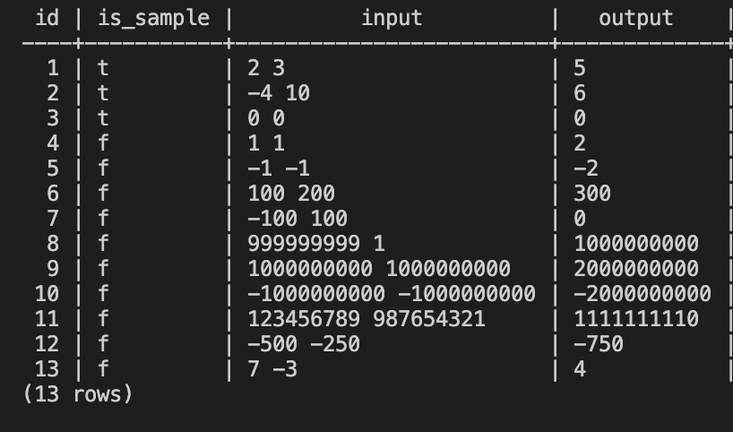
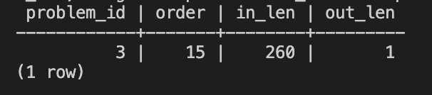
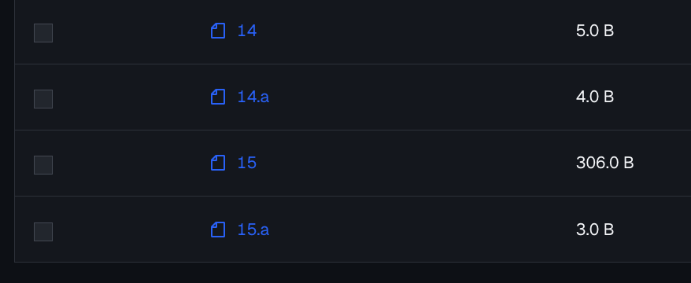

# Issues Analysis

> **Instructions**: Document the three highest-priority product issues and the three highest-priority code issues. Rank the issues within each category from highest to lowest priority.
> Replace the example entries with your actual findings and explain why each issue deserves its priority. Complete all four questions in the Edge Case Analysis section.
> Rename this file to `ISSUES.md` before submitting.

## Summary

| Type           | Critical | High | Medium | Low | Total |
| -------------- | -------- | ---- | ------ | --- | ----- |
| Product Issues | 0        | 1    | 1      | 1   | 3     |
| Code Issues    | 1        | 2    | 0      | 0   | 3     |

---

## Product Issues

> Product issues are user-facing problems: broken functionality, missing validation, poor UX, data integrity risks visible to users.

### [P1] No sample tests, and no warning

**Severity**: High

**Location**: It is populating success message after clicking “Create/Update problem in Database” in `problems/views.py` 

**Description**:  
I have tested on problem `634371` had 0 sample test cases and 15 regular testcases on polygon. Button displayed success not Error/blocking and not even warning. All 15 rows in `problems_problemtestcase` had `is_sample = f`.

**Impact**:

- Student who opens migrated problem unable to understand the problem clearly without samples cases.
- It is not populating any warning the person who migrated that problem will think everything fine Working.

**Suggested Fix**:  
Warn or stop the migration until one or more sample test cases exists.  

---

### [P2] Statement shows raw Polygon markup

**Severity**: Medium 

**Location**:  `problems/views.py:63` and `problems/templates/problems/index.html` at the legend, input, output, and notes blocks (about lines 207, 215, 223, and 231).

**Description**:  
After fetching `633995`  problem from polygon , those four sections showed `
` tags and math like $$$a$$$. The regex codes removes only empty leading `

`. 

**Impact**:

- Student or user has to read tags & dollar signs instead of normal statement.
- It is impacts user experience.

**Suggested Fix**:  
It would turn the polygon HTML into readable text, and render the math properly.

---

### [P3] Duplicate title shows a database error

**Severity**: Low

**Location**: `problems/models.py:60` (`slug` is unique) and the error banner in `problems/views.py` where the failure reason is `str(e)` (around line 553).

**Description**:  
I fetched `634371`, title “Sum of Two Numbers,” chose Easy and the tags `math` and `addition`, and clicked button “Create/Update problem in Database” The banner shows the migration was rolled back because `problems_problem_slug_key` already had `sum-of-two-numbers` . Here nothing was saved this expected behaviour but the problem is that the banner populates raw error not polished response.

**Impact**:  
It impacts user experience We should not show raw response to the user. 

**Suggested Fix**:
Response should be polished like "Problem with name `sum-of-two-numbers` already existed".

---

---

## Code Issues

> Code issues are technical problems: bugs, security vulnerabilities, performance problems, code quality concerns, architectural issues.

### [C1] Fetch crashed: `notes` column missing

**Severity**: Critical

**Location**: `problems/models.py:81-82` and `problems/migrations/0001_initial.py`. The repair is `problems/migrations/0002_problem_genie_chat_problem_notes.py`.

**Description**:

On a fresh database, fetching a problem returned a 500. The page directly returned  `column problems_problem.notes does not exist`. The model exists `notes` and `genie_chat` . `0001_initial.py` doesn't migration of notes column.BUt notes is using in  file `problems/views.py` at lines 355 and 380 while creating problem. And notes field not even exists in docstring of problem model.

**Impact**:

- The model still expects for `notes field` as soon as you fetch a problem.
- Page shows the yellow error page: `column problems_problem.notes does not exist`.
- User will face crash on page.

**Suggested Fix**:  
The migration has to be created as the new model fields. I have already did that in `0002`.

---

### [C2] Re-migrating tests leaves the old rows

**Severity**: High

**Location**: `problems/views.py:514-547`

**Description**:  
The problem id `633995` had 13 test cases. I have deleted 2 on polygon, leaving 11 as it is then clicked “Migrate Test Description to Database.” The banner shows success. `test_case_count` became 11. `problems_problemtestcase` still had 13 rows. Rows 1–11 were updated. Rows 12 and 13 are still visible in DB. The bucket was correct, with 22 objects. The loop updates `existing_test_cases[idx]` and never deletes past rows. 

**Impact**:

- User assumes that 11 test cases updated cleanly with success banner. Rows 12 and 13 are not on that page, but the old tests are still stored.
- `problems_problemtestcase` still has those two deleted test cases. The problem row says 11. The test table has 13.

**Suggested Fix**:  
After updating loop of testcases, `problems_problemtestcase` the old rows  should be delete for that problem that were not updated in this run.

---

### [C3] Long test cases are cut to 260 characters in the database

**Severity**: High

**Location**: `problems/views.py:517-525`

**Description**:  
"Migrate Test Description to Database" uses the same code for every problem. It stores only first 260 characters of input & output,then shows success. I have tested this with a long test. The bucket stores as `test_cases/3/15` had 306 bytes. But the database stored as 260 characters.

**Impact**:

- The page says success but we are loosing data silently. The input & output are correct with polygon and bucket.
- This will effect every problem mostly, not only 1 testcase . Large test cases are normal in ploygon.

**Suggested Fix**:  
Need to save full input and output . The database column can hold long text. If a limit is still needed, has to warn the user when test case is longer than limit instead of cutting it quitely.

---

---

## Edge Case Analysis

### Q1

> A Polygon problem has 0 sample test cases but 15 regular test cases. What happens when you migrate this problem?

The problem saved as id 3 with no sample (test cases) rows. All 15 rows in `problems_problemtestcase` had `is_sample = f`. It didn't show any warning while adding the problem test cases.

 

---

### Q2

> A problem is migrated with 20 test cases. Later, the problem setter removes 8 test cases on Polygon (now 12 remain). The problem is re-migrated. What happens?

I have checked on this scenario - Problem `633995` had 13 tests. I deleted 2 on Polygon and migrated again.  

The storage bucket has correct count of objects (22 objects - 11 testcases). `problems_problemtestcase`  database still have 13 entries. Rows 12 & 13 are not removed.

---

### Q3

> Two different Polygon problems have the exact same title: "Two Sum". You migrate the first one successfully. Then you try to migrate the second one. What happens?

The page showed a duplicate-slug error for `sum-of-two-numbers` But Database id 2 was used. After rename ,the problem saved as id 3 , slug `sum-of-two-numbers-b` . The storage bucket path is test_cases/3/

---

### Q4

> When test cases are saved to the database via "Migrate Test Description to Database", some data is intentionally discarded. What data is lost? Why might this cause problems?

 "Migrate Test Description to Database" cuts test data before it saves.  
The input and output are cut to 260 characters.  
Test 15 was 306 bytes in test_cases/3/15 storage and 260 characters in the database.

---

## Severity Guidelines

Use these definitions when assigning severity:

| Severity | Definition | Examples |
|----------|------------|----------|
| **Critical** | System broken, security vulnerability, data loss | SQL injection, authentication bypass, data corruption |
| **High** | Major functionality broken, significant data integrity risk | Feature doesn't work, orphaned records, race conditions |
| **Medium** | Feature partially broken, poor UX, code maintainability | Missing validation, confusing errors, code duplication |
| **Low** | Minor issues, cosmetic, best practice violations | Unused imports, inconsistent formatting, missing logs |

---

## Notes

[Add any additional observations, patterns you noticed, or architectural concerns that don't fit into specific issues above]
